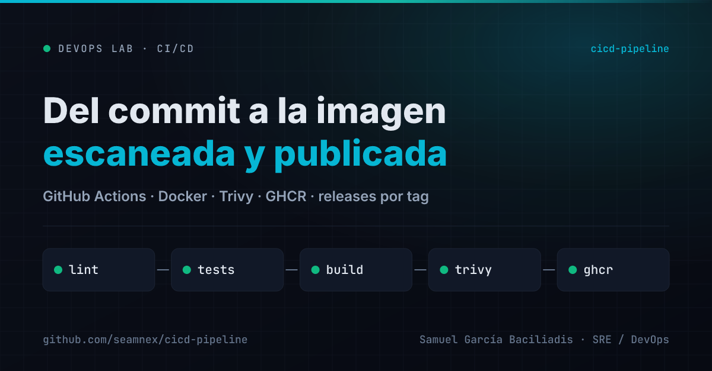
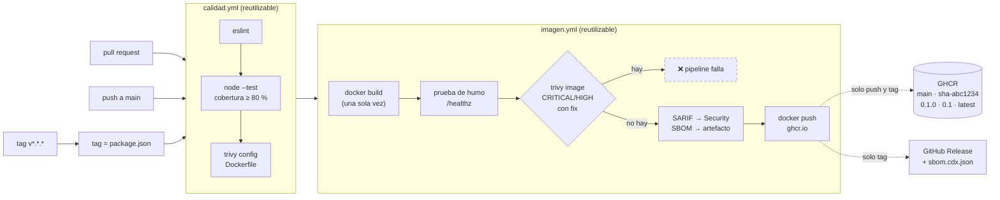

# CI/CD Pipeline — Del commit a la imagen publicada

[](https://github.com/seamnex/cicd-pipeline/actions/workflows/ci.yml)
[](https://github.com/seamnex/cicd-pipeline/actions/workflows/release.yml)



Pipeline de GitHub Actions que lleva una API chica desde el commit hasta una
imagen **escaneada** y publicada en GitHub Container Registry, con releases por tag.

> Parte de mi ruta de especialización en SRE / DevOps.
> Contexto: vengo de gestión de incidentes P1/P2, donde una parte grande de los
> incidentes arranca con un cambio. Acá practico el otro lado: el camino que
> recorre ese cambio antes de llegar a producción.

---

## El problema

En un War Room, una de las primeras preguntas es **"¿qué cambió?"**. Y la
respuesta muchas veces es incómoda: una imagen que nadie sabe exactamente de qué
commit salió, construida en la máquina de alguien, con una capa base que trajo
una vulnerabilidad que nadie miró.

Un pipeline no evita que un cambio salga mal. Lo que hace es que **cada cambio
sea trazable, verificado y reproducible**, para que la pregunta "¿qué cambió?"
tenga una respuesta en segundos.

## La solución

La app es lo de menos: una API de estado de cuatro rutas en Node 24, sin
dependencias de runtime. Lo que importa es el camino que recorre:

1. **Calidad** — lint, tests con piso de cobertura y escaneo de configuración del Dockerfile.
2. **Imagen** — se construye **una sola vez**, se prueba que arranque, Trivy la escanea y
   recién ahí se publica **esa misma imagen**.
3. **Release** — un tag `vX.Y.Z` publica tags semver y crea el GitHub Release con el SBOM adjunto.

---

## El pipeline



| Evento | Calidad | Build + escaneo | Push a GHCR | Release |
|---|---|---|---|---|
| Pull request | ✅ | ✅ | — | — |
| Push a `main` | ✅ | ✅ | `main`, `sha-xxxxxxx` | — |
| Tag `v0.2.0` | ✅ (y tag = `package.json`) | ✅ | `0.2.0`, `0.2`, `latest`, `sha-xxxxxxx` | ✅ con SBOM |

### Decisiones que vale la pena explicar

**Lo que se publica es exactamente lo que se escaneó.** La imagen se construye con
`load: true`, Trivy la escanea en el daemon local y el push sube esa imagen con
`docker push --all-tags`. Construir de nuevo para publicar abriría la puerta a
que la imagen escaneada y la publicada sean distintas.

**La compuerta falla solo por CRITICAL/HIGH con fix disponible.** Una CVE sin
parche no se resuelve bloqueando el deploy. Bloquear por lo que no se puede
arreglar entrena al equipo a saltearse la compuerta, que es peor que no tenerla.
Lo que no bloquea igual queda visible: el reporte completo va a la pestaña
**Security** del repo en formato SARIF.

**Las actions de terceros están fijadas por SHA, no por tag.** Un tag como `@v4`
se puede mover. En marzo de 2026, 76 de los 77 tags de `aquasecurity/trivy-action`
—la misma action que usa este pipeline— fueron reescritos para apuntar a código
que robaba credenciales del runner
([CVE-2026-33634](https://cve.circl.lu/cve/CVE-2026-33634)). Con el SHA, lo que corre es lo que revisé; el comentario al lado dice
a qué versión corresponde.

**Sin secretos guardados.** El push a GHCR usa el `GITHUB_TOKEN` efímero del job,
con `packages: write` declarado solo en el job que lo necesita.

**El release no tiene atajos.** `release.yml` llama a los mismos workflows
reutilizables que `ci.yml`, y además verifica que el tag coincida con la
versión de `package.json`. Si no coinciden, el release no sale.

---

## Requisitos

- **Node.js 24** (para lint y tests locales)
- **Docker** (para construir y correr la imagen)
- Opcional: **Trivy** —o su imagen Docker— para reproducir el escaneo

## Cómo ejecutarlo

```bash
git clone https://github.com/seamnex/cicd-pipeline.git
cd cicd-pipeline

npm ci
npm run lint
npm test          # 7 tests, falla si la cobertura de líneas baja del 80 %
```

Construir y correr la imagen:

```bash
docker build --build-arg APP_VERSION=0.1.0-local -t status-api:local .
docker run --rm -p 8080:8080 status-api:local

curl http://localhost:8080/api/v1/status
# {"service":"status-api","version":"0.1.0-local","uptime_seconds":3}
```

O directamente la imagen publicada por el pipeline:

```bash
docker run --rm -p 8080:8080 ghcr.io/seamnex/cicd-pipeline:latest
```

| Ruta | Para qué |
|---|---|
| `GET /healthz` | Liveness: el proceso responde. No consulta dependencias. |
| `GET /readyz` | Readiness: pasa a `503` al recibir SIGTERM, para salir del balanceo antes de cerrar. |
| `GET /api/v1/status` | Nombre, versión inyectada en el build y uptime. |
| `GET /metrics` | Contador e histograma en formato Prometheus. |

Reproducir el escaneo de Trivy con la misma versión que el CI:

```bash
docker save status-api:local -o status-api.tar
docker run --rm -v "$PWD:/w" aquasec/trivy:0.76.1 image --input /w/status-api.tar \
  --severity CRITICAL,HIGH --ignore-unfixed --exit-code 1
```

Publicar un release:

```bash
npm version patch --no-git-tag-version   # 0.1.0 -> 0.1.1 en package.json
git commit -am "Release 0.1.1"
git tag v0.1.1
git push origin main v0.1.1
```

---

## Bitácora

**Entorno local:** Windows 11 · Docker Desktop 29.6.2 · Node 24.19.0 · Trivy 0.76.1
(imagen `aquasec/trivy:0.76.1`). **Fecha:** 05/11/2026.

### Calidad

| Verificación | Resultado |
|---|---|
| `npm run lint` | 0 errores |
| `npm test` | 7/7 tests · cobertura de líneas 100 % · funciones 92,3 % |
| `npm audit` | 4 moderadas en devDependencies → **0** tras el override (ver abajo) |
| `trivy config` sobre el Dockerfile | 1 HIGH (DS-0002) → **0** tras agregar `USER` |
| `actionlint` 1.7.7 sobre los 4 workflows | 1 aviso de shellcheck → **0** |

### La imagen

Contenedor corriendo localmente: healthcheck `healthy`, usuario `65532`,
`docker exec … sh` falla porque **no hay shell**, y ante `docker stop` el
`/readyz` respondió `503` durante el período de gracia y el proceso salió con código 0.

La elección de la base, con números y no por costumbre. Misma app, dos bases,
mismo Trivy, mismo día:

| Base | CRITICAL | HIGH | MEDIUM | LOW | ¿Pasa la compuerta? |
|---|---|---|---|---|---|
| `node:24-alpine` | 0 | **6, todas con fix** | 12 | 1 | ❌ No |
| `distroless/nodejs24-debian13:nonroot` | 0 | 1, sin fix | 36 | 8 | ✅ Sí |

Las 6 HIGH de Alpine están en `undici` y `brace-expansion`, que vienen con el
**npm empaquetado en la imagen**. La app no usa npm en runtime: eran
vulnerabilidades en código que la imagen cargaba sin necesitarlo. Distroless no
trae npm, y el problema desaparece sin parchear nada.

Ojo con leer la tabla al revés: distroless tiene **más** hallazgos en total
(45 contra 19). Lo que cambia es que ninguno tiene fix disponible, y que ninguno
está en código que la app pudiera no necesitar.

### El HIGH que no cierra

El único HIGH de la imagen final es `CVE-2026-76844` sobre `zlib1g`. Pero la
descripción que trae la base de datos de Trivy habla de
**`webpack-dev-middleware`**, un paquete de Node que no tiene nada que ver con zlib.

No lo resolví y no lo silencié: lo dejo documentado. Pero es la lección más útil
del escaneo. **Un reporte de vulnerabilidades es un dato a triar, no un
veredicto.** Si la compuerta hubiera fallado por esto, la respuesta correcta
habría sido abrir el advisory, confirmar si `zlib1g` está afectado de verdad y
—si no— suprimirlo en un `.trivyignore` **con el motivo escrito al lado**. Lo que
no hay que hacer es bajar la severidad de la compuerta para que pase.

### En GitHub Actions

**Fecha:** 06/11/2026 (UTC). Runner `ubuntu-24.04`.

| Corrida | Resultado | Duración | Qué dejó |
|---|---|---|---|
| `ci` — push a `main` | ✅ | 1 m 51 s (calidad 16 s · imagen 89 s) | `ghcr.io/seamnex/cicd-pipeline:main` y `:sha-b917758` |
| `release` — tag `v0.1.0` | ✅ 4/4 jobs | 1 m 37 s | `:0.1.0`, `:0.1`, `:latest` + [GitHub Release](https://github.com/seamnex/cicd-pipeline/releases/tag/v0.1.0) con `sbom.cdx.json` |
| `ci` — [PR #1](https://github.com/seamnex/cicd-pipeline/pull/1), base `node:24-alpine` | ❌ **frenado a propósito** | — | `Total: 6 (HIGH: 6, CRITICAL: 0)` en la compuerta; no se publicó nada |

Tres comprobaciones que no dependen de mirar el tilde verde:

- **La compuerta frena lo que tiene que frenar.** El PR #1 existe solo para eso:
  cambia la base a Alpine y el pipeline lo rechazó con las **mismas 6 HIGH**
  que el escaneo local (4 en `undici`, 2 en `brace-expansion`, todas dentro de
  `usr/local/lib/node_modules/npm/`). Un control que nunca vi fallar es un
  control que no sé si funciona.
- **El reporte de la pestaña Security cierra con el escaneo local:** 45 hallazgos
  en code scanning, igual a 1 HIGH + 36 MEDIUM + 8 LOW del escaneo en mi máquina.
- **La imagen es pública de verdad:** `docker pull ghcr.io/seamnex/cicd-pipeline:main`
  sin login funciona. El paquete heredó la visibilidad del repo.

---

## Qué me llevo de este lab

**1. La compuerta tiene que poder fallar por algo que se pueda arreglar.**
El primer instinto es `severity: CRITICAL,HIGH` y `exit-code: 1`, sin más. Con
la base Alpine, eso habría bloqueado cada deploy por vulnerabilidades del npm
empaquetado, y la presión para "destrabar el deploy" termina siempre en lo
mismo: alguien comenta el paso. Separar *lo que bloquea* (con fix disponible) de
*lo que se reporta* (todo, en SARIF) es lo que hace que la compuerta sobreviva
al primer viernes a las 18 h.

**2. La imagen más chica no es la que tiene menos CVEs: es la que tiene menos cosas.**
El salto de Alpine a distroless no se ganó parcheando nada, se ganó **sacando**
cosas. Es el mismo principio que en un incidente: el componente que no existe no
se puede caer.

**3. "¿Qué cambió?" tiene que tener respuesta en segundos.**
Cada imagen publicada lleva el SHA del commit en un tag (`sha-abc1234`), la
versión en `/api/v1/status` y labels OCI que apuntan al repo. En un incidente,
`curl /api/v1/status` dice qué versión corre, y el tag dice de qué commit salió.
El SBOM adjunto a cada release contesta la otra pregunta típica del War Room:
"¿estamos afectados por la CVE que salió hoy?".

**4. La cadena de suministro empieza en el YAML del pipeline.**
Fijar las actions por SHA, pinear Trivy a `v0.76.1` y la imagen base por digest
parece burocracia hasta que un tag se mueve. Un pipeline que descarga "la
última versión" de todo no es reproducible: la misma corrida puede dar verde
hoy y rojo mañana sin que nadie haya tocado el repo.

---

## Próximos pasos

- [ ] Firmar la imagen con cosign y generar attestation de procedencia (SLSA)
- [ ] Renovar automáticamente el digest de la imagen base (Dependabot o Renovate)
- [ ] Desplegar la imagen en el [k8s-lab](https://github.com/seamnex/k8s-lab) desde el pipeline
- [ ] Triar el `CVE-2026-76844` contra el advisory original

## Estructura

```
cicd-pipeline/
├── .github/workflows/
│   ├── ci.yml          # PR y push a main: calidad -> imagen
│   ├── release.yml     # tag v*.*.*: versión -> calidad -> imagen -> GitHub Release
│   ├── calidad.yml     # reutilizable: eslint, tests, trivy config
│   └── imagen.yml      # reutilizable: build, humo, trivy, SARIF, SBOM, push
├── src/
│   ├── app.js          # rutas y servidor (sin listen)
│   ├── metrics.js      # contador + histograma en formato Prometheus
│   └── server.js       # entrypoint: listen + apagado ordenado ante SIGTERM
├── test/
│   └── app.test.js     # node:test, servidor en puerto efímero
├── docs/card.png
├── Dockerfile          # distroless nonroot, base fijada por digest
├── eslint.config.js
└── package.json
```

## Licencia

MIT
